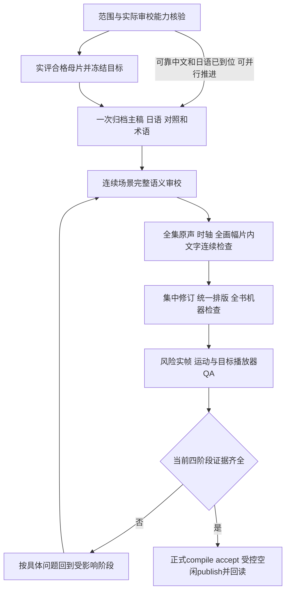

> 2026-10-15 文档整理：本文保留按日期演进的设计与实现记录。当前执行以 [项目规则](PROJECT-RULES.md)、[两阶段制作](SUBTITLE-TWO-PASS.md) 和 [定时任务](AUTOMATION.md) 为准；旧 accepted 前置、已看 experience、迅雷优先/UI heartbeat 或历史周期不自动恢复。

2026-10-15 用户最新更正：执行 [每集v0→v1双版本流程](SUBTITLE-TWO-PASS.md)。先上架v0观看版，紧接着由同一负责人完成v1精校细调；画面字、主动查找并制作OP/ED歌词、位置避让、必要动效及改写语义/时轴回查是每集v1必做项，不能为快整项省略。具体无解项留实际尝试和证据后归档，不卡几天。已看集保持原字幕，不自动回修。v0交付后不释放唯一writer，v1处理及输出完成才结束；保留两个观看入口。此条覆盖下文旧“首版即停止、只等新材料修订”安排，旧内容留作历史。

# 高质量字幕生产流水线 v1

2026-10-14 用户最新更正覆盖本文旧首版门槛：以完整可看的熟肉成品为本轮结束条件，先交付、疑点随版本保留、增量修订；不再陷入模型和验收循环。执行 [熟肉交付流程](SUBTITLE-DELIVERY-FIRST.md)。完整原声/语义审校仍是质量记录，不能伪造，已不作为首版本地成品的阻塞条件。魔王E2已按新标准实际输出1080p整集并接入字幕库。

2026-10-13用户后续更正优先：药屋/乱马E2已看完，取消其优先交付试点，保留为低优先经验样本。材料就绪后独立会话持续完成新未看一集，晚稿V2增量核验；定时只准备/派发/跟踪，不再轮转写正文。单集调度代码、保护及工具流程见 [SUBTITLE-DELIVERY.md](SUBTITLE-DELIVERY.md)。本文前一轮审计数值保留为历史快照，涉及“药屋E2首交付”“尚未落实调度”的旧段落由新契约覆盖，以最新部署回执为准。

制定日期：2026-10-13。针对用户提出的“制作太慢，保证质量，分析实际耗时并建立流水线”。本文补充 [VIEWING-WORKFLOW.md](VIEWING-WORKFLOW.md) 的生产节奏，不放宽任何质量、个人范围、下载、媒体绑定或发布门禁。

本次完成现状核验和执行流程设计。现有代码与实际已执行结果分别标明；单写入编辑接口、自动依赖缓存和完整阶段计时仍是待实施项，不能将本文作为部署或成品回执。

## 1. 当前交付情况与耗时

2026-10-13 10:09:30–10:11:33（北京时间）只读核验：在追 API 有19集制作任务、143份来源记录；私有档案库正式 builds=0、accepted=0、selection=0。宿主母片 targets、heads、publications 均为0。**正常完整完成并激活的自制字幕为0集。** 局部预览、书面校订和源数量都不是成品。

| 当前重点 | 书面已校订原始 parent / 总数 | 已校订显示事件 | 未决显示事件 | 整集结果 |
|---|---:|---:|---:|---|
| 药屋 568244 / E2 | 362 / 370 | 352 | 8（总360） | 未验收 |
| 乱马 637802 / E2 | 230 / 247 | 245 | 17（总262） | 未验收 |
| 飙马 639938 / 本地E1 | 338 / 352 | 330 | 14（总344） | 未验收 |

parent包括原对白、片内文字和署名等条目；显示事件会因拆并句变化。两种计数不混用，不把文字覆盖比例叫整集完成率。飙马本地E1对应已核映射的 S06E02，不因本流程修改季集。

| 时间口径 | 核实结果 | 能说明什么 |
|---|---|---|
| 首个明确逐集接入/样片交接到本次快照 | 10/10 22:12 → 10/13 10:11，约60小时 | 制作已经持续约两天半的日历跨度；包含搭建、等待、研究和返工 |
| 药屋E2首可靠中文归档到快照 | 10/11 14:37:56 → 10/13 10:11，约43.6小时 | 输入已到位至今仍未交付；不是43.6小时纯制作工时 |
| 乱马短片ASR | 40秒音频，97.82秒，含首次模型取得/加载/推理 | 仅该短样本计时，不推算全片速度或准确率 |
| 药屋短片ASR | 18秒音频，45.82秒 | 仅该短样本，不证明实际听核 |
| 完整一集实际制作工时 | 无法核实 | 尚无完整成品，且现有批次没有有效的连续阶段计时 |

旧批次主要有收尾 time/updated/recorded_at，没有成对的有效开始/结束记录。文件mtime、revision时间和批目录0826等名字不算开始时间。不给“每集几小时”承诺，也不能计算提速倍数。私有数值及证据路径见 `data/subtitle-studio/efficiency-audit-20261013/AUDIT.json`。

三集当前书、plan与acceptance-plan的书hash一致，旧并发冲突目前已消失。母片只读接口已实际HTTP200返回空目标，**旧计划中的404不能继续作为当前阻塞**；这也不证明母片冻结、发布或播放已成功。当前缺口是实际执行和证据闭环。

## 2. 为什么投入多却没有成品

1. **最终验收能力没有先跑通。** 三集仍没有整集真实听核、连续声画运动、全画幅片内文字和目标播放器验收。原生日文、ASR或导出的音频不能代替实际听过。多加文字agent也不能关闭声音义务。
2. **批次太碎，局部QA和记录负担过大。** 飙马10/13的0826批只新增2个对白parent，却为4事件预览生成并实看16张PNG，另实看8张原帧、维护多份专用脚本与交接；结束时14未决、69日语速度警告及听核/运动/播放器仍开放。这些图片有局部价值，但没有关闭最终瓶颈。现有计时不足，不能声称它们占了多少百分比工时。
3. **多个接近完成的工作稿轮转，缺少完集负责人。** 发现变化需要扫描全部在追，编辑和验收则需要持续围绕一个交付目标。最近大量轮转停在混声、切点、片内文字和播放器问题，新增两句容易，关闭这些共同缺口困难。
4. **并行结果没有统一合并口。** Kimi媒体研究的生产追加曾两次因当前书和计划不同步被preflight拒绝。保护应保留，解决办法是单写入与版本合并，不能绕过hash守卫。
5. **全稿重复审读和证据错绑造成返工。** 外部文字提案需要独立核验，实际出现过误读片内文字和观察关联错cue；不能省掉审核，但应围绕变化、原句引用和实际疑点交付，避免每轮再通读同一全集。

首要优化是减少重复准备、细碎QA、冲突和无法关闭的问题循环；完整语义及四阶段验收继续保留。

## 3. 执行责任与在制数量

优先实际**新未看且就绪的一集**交付。药屋/乱马E2已看完，不再占首交付槽；旧稿保留经验研究。当前优先准备魔王E2，其次学生会E2：已有完成媒体/中文候选，但可靠日语对白、母片实评及听核/连续QA能力仍需补齐。材料齐后独立单集会话完成冻结、语义和四阶段至发布。

试点期间维持 **1集主生产＋最多1集材料预备**。全部在追继续低成本范围扫描、既有后台查源和原稿归档；不删除、不取消其它在途或未知任务。主集因真实能力/材料阻塞无法继续时，记录关闭动作，再将可操作的另一集提升为主集，不在同一个无能力步骤反复试跑。

| 责任 | 执行内容 | 写入权限 |
|---|---|---|
| 完集负责人 | 固定目标、协调场景批次、统一术语、合并争议、跟进四阶段至发布 | 唯一正文/计划提交者 |
| 并行文字审校 | 按冻结输入审查连续场景、原文引用、术语和差异，提出修订 | 独立proposal；不写live书或accepted字段 |
| 声画审校 | 有实际听音/连续画面能力的审校者完整复核并处理疑点 | 实际observations；没有能力则保持阻塞 |
| 本机后台 | 现有门禁、下载队列、完成对账、不可变档案与机械检查 | 原授权范围内的既有入口 |

并行agent做提案和独立核验；对有争议、否定、关系、数值、笑点和分句的条目重点独立复核，但**所有parent及显示child仍须完整语义审阅**。更多agent不等于更多独立译者；简繁/同文包不重复算来源。

## 4. 单集标准作业

材料归档和语义工作稿可与母片评审并行，不因未冻结而暂停可靠文字工作；声画时轴、视觉验收及正式accept必须等待合格目标冻结，并核对最终媒体和引用映射。母片改变后重新检查受影响决定，不能沿用另一目标的接受证据。

### A. 开工前：先证明能完成最后一步

核selected/watching、无cleanup_hold、原独立授权、有效政策、映射/盘点和本集边界。检查当前book/plan/母片目标，读取真实下一动作。

先以本集一个普通对白＋一个高风险短场景测试：审校者是否能实际接收并听辨原声、观察连续运动，非默认QA播放器是否能显示当前ASS和精确字体；验证冷启动、播放推进和字幕像素。没有听音能力就明确记录 `original_audio_review_unavailable`；音频文件导出、ASR或静帧成功不能关闭它。不启动Computer Use，不让用户观看被桌面操作打断，不将音频自动上传外部服务。

短测试只验证工作通道，不关闭整集阶段。现有允许路径不可用时，下一工程工作是补可用的原声/连续预览审校通道，或取得有真实能力的审校结果；其范围、时间、来源和媒体hash必须能回读。不能先accept来解锁预览。

### B. 母片和输入：一次准备，先冻结再验时轴

复用本集已有完成媒体，核实际身份、季集、归属、完整性、日语声轨、无烧录对白、广告排除和保真。通常一个主候选＋一个对照，第三份沿本集具体问题/证据例外。没有实际观察不声称全片洁净。

用已有受控production-target接口冻结合格母片。研究目标和过渡播放媒体分开，保留旧稿；不同目标不能继承旧声音/时轴/视觉验收。不能直接写episodes绕过受控绑定。

一次归档：贯穿全片中文主稿、日语/原声依据、1–2份可取得的独立中文对照；同文归并，核剪辑/时轴版本，建立本作品术语与语气表。可靠单中文＋可核日语可先启动，独立稿不足如实记录；完整原声独立核对通过后可按现行规则交付，不无限等第二译者。药屋E2和乱马E2的duration_ms当前为空，应实际probe确认，不能借其它集时长补值。

### C. 文字：连续场景推进，不每两句建一套QA

通常20–40个原始parent一批，按场景、人物和完整语义划分；最后只剩8个疑难项时按共享问题成组处理，不为凑批次增加无关复核。

记录原中文、完整日语出处、最终提案、理由、待听点和是否改轴。否定、人物关系、数值、专名、笑点和遗漏逐项裁决，不多数票拼稿。相邻共享日语parent同组核对，保留原句与父子覆盖。

能确定的文字先统一合并；需听音、镜头或手势才能确定的保持待决，并附具体片段/问题。不把translation_reviewed直接转accepted，不为绕布局警告缩字、挤字、增加普通对白行数或均分时长。

此阶段做自动差异/引用/覆盖/异常检查。人工静帧只服务新的明确视觉问题；普通短句的纯字面修改不自动触发整套多尺寸截图实验。最终全书测宽、字体和实帧义务仍在F/G集中完成。

### D. 声画与片内文字：同一区间集中听看，保留全片覆盖

把同一区间的共享语句、漏反应、说话人、拆并句切点、速度警告、片内文字和遮挡合并为一个问题组，给上下文和待回答问题，避免同片段反复准备素材。

在精确母片上完整实际听核、连续全画幅检查；记录覆盖时段、检查者和实际观察。检查每个需要的原声/时轴义务，完整寻找必要标题、路牌、短信和画面文字；OCR/ASR只定位候选。全片连续检查和高风险反复核对可以在一次会话中分别留证，不要求为四阶段机械地各看一遍，也不能用少数静帧替代全片覆盖。

边界用真实源PTS/time_base与实际声音和镜头核对。快seek请求时间不是精确帧时间；同一问题一次准备源帧/音频索引后复用。原生日语时间、1ms相邻边界或无字幕画面不等于真实静音。修正后复核邻接场景。

药屋E2先关闭：8个未决、cue3与原JP免责声明碰撞、26JA＋1CN速度警告、必要片内字首尾与运动。重复署名/片内字可判无需新翻译，但必须有实际分类和覆盖决定，不能删原稿补齐覆盖。

### E. 合并与排版：一个写入者、一份真实正文

维持中文在上、日语在下，每语言一行；长句按语义和实际原声边界拆分，保留parent/child且新child重新审阅。当前真实Medium500、中64/日46是本地候选，只有实际测宽/fontselect/实帧成立时沿用，不批量改其它集。

用已经核验的普通对白样式和字体，特殊位置/动效仅处理真实问题。片内文字先判断必要性，避免为了装饰添加字幕、重复信息或额外阅读负担。术语表可跨集复用；每集出现的新语境仍要核查，样式模板不能携带验收。

提交前检查expected workbook SHA、plan版本及原句；三方合并“基准/提案/最新书”。不同条目可合并，同条目内容或来源已改则重核；只新增candidate/inventory的后台刷新也必须保留。当前已有手工守卫可先沿用；统一save_patch与单集租约尚待工程实现。计划中的lease字段本身不证明已经取得有效租约。

### F. QA：全书机器检查一次组织，人工检查按风险闭环

当前全书运行来源/父子覆盖、JA出处、双语行数、真实字体逐行测宽、读速/重叠、ASS选字和当前hash报告。逐项解释/修正警告，禁止批量waiver。已知styles/fonts不变也不免除当前报告。

集中生成和实看全尺寸及实际640px PNG，覆盖新长句、浅色/高频背景、切换、sign和具体遮挡问题；保留逐图hash、IHDR尺寸、当前报告归属和实际font_selection_report。contact只供找风险，不算独立小图实看。

再看连续高风险动作和过渡，并在目标播放器检查实际字幕像素、双语两行、字体、冷启动、缩放、暂停seek、正常对白及控制条显隐；记录真实失败。修正后重做受影响区间与邻接场景；静帧结果不能关闭声音、完整运动或播放义务。

### G. 验收发布：真正交付才计为一集

所有语义、原声时轴、片内文字、渲染/播放真实证据齐全，当前完整book/媒体/输出/字体hash一致，沿正常正式compile、accept与受控publish路径发布；发布前再次核范围、身份、归属和播放器空闲状态。

回读正式目标、成品及实际默认轨/字体和加载结果。已授权验收后激活无需再问用户确认；网页与外部播放保护均满足后，下次打开使用成品。旧媒体、原轨、旧字幕、观看记录和活动会话保留；不能将研究样本的accept视为正式播放已切换。公开分享仍需另行明确授权。

## 5. 新输入来了，重做哪些工作

下表是依赖管理设计；当前完整accept仍必须重新绑定当前完整输入，不能直接拼接旧accept证书。

| 变化 | 必须重做 | 可以有限复用 |
|---|---|---|
| 新组/晚稿 | 本集对齐后的正文diff、实际差异和来源核验 | 未改的已审决定；不重复全文提案 |
| 仅中文改字 | 该句语义、读速、测宽、渲染及邻接语境 | 同目标的未变原始帧；原声证据须确认语义映射不受影响 |
| 日语/引用/拆并句/时码变化 | 父子覆盖、完整语义映射、该区间原声时轴及邻区声画/视觉QA | 未受影响的原始素材和实际观察，保留出处 |
| 位置/sign/动效变化 | 区间视觉、遮挡、运动及阅读负担 | 未改文字的语义证据 |
| 字体/全局样式变化 | 全书测宽/选字与受影响实帧、运动和播放器检查 | 原声/原始文本素材；旧图片不直接称当前图片 |
| 母片/剪辑版本变化 | 新目标、映射、完整母片资格和本集声画/视觉/播放器 | 作为上下文的旧决定和术语；不继承旧目标接受 |

缓存键至少绑定媒体指纹、源PTS、原始素材hash、相关事件/邻事件内容时码、样式/字体/renderer版本和检查类型。实际实看的旧PNG只有完全相同SHA、已知渲染/字体/目标出处且列入当前报告时可窄范围复用；明确标原始检查、复用和本轮新检查。机械缓存命中不算新成果，也不能复用旧整集验收。

## 6. 计时和进度：以交付与关闭问题衡量

从试点开始，各阶段记录started_at/finished_at和单调时钟elapsed；审校会话执行、机器运算、队列等待、能力/材料阻塞分别记录，不从旧mtime反推。并行时间相互重叠，不把各agent经过时间相加称整集工时。

每轮run记录：输入/输出SHA、阶段和执行者、真正新增或修订parent、待决问题及关闭证据、返工原因、冲突次数、新实看/复用图片、机器/审校/等待时间、下一操作。一个重复的check报告或额外阴影层不算新增翻译。

每集对用户只报告：文字条目已审/未决；四阶段分别通过或缺什么；是否已经正式发布。内部对比首稿到交付的总经过时间、实际可计时工作、等待、返工和一次验收结果。首个合格集完成后，再对另外两集验证可复用性，才设稳定的时长目标。

共享PROGRESS/HANDOFF每轮写短结果与run链接，不再将全部静帧/字段审计全文重复进去；私有详细证据和旧历史完整保留。两文件当前各约0.9MB，继续膨胀会增加恢复阅读和并发写入成本，但不能删除历史。归档索引/简短当前状态属于后续维护，不自动移动或截断既有文件。

## 7. 落地顺序

1. **已完成：** 只读现状/耗时审计、本流程及统一runbook过期母片实现描述更正。没有生成验收或切换媒体。
2. **首要：** 药屋E2能力短测试，核实际声音/连续运动/非默认播放器通道；合格母片实评和受控freeze。已有HTTP200路由无须先重启服务。
3. **第一集闭环：** 8项未决与已知失败集中解决，完整听核/全画幅检查、当前全书QA、真实播放器验收、accept和空闲publish。能力未补齐就继续明确阻塞，不能承诺无人值守交付。
4. **小工程优化：** 单写入save_patch/租约、后台refresh合并保护、统一问题队列与阶段计时；再做依赖索引和可复用批处理。临时数据库/假下载器验证并发、冲突、hash失效、活动播放保护；禁止真实提交测试。
5. **稳定扩展：** 一集完成后再把同流程用于下一集，保持WIP限制与每集新稿发现。先不做整套API/worker重构或增加定时任务数量；现有每小时两条任务与qB唯一后台提交边界保持。

## 8. 依据与限制

本流程的WIP数量、角色和场景批次是基于本机失败与交付现状制定的执行选择，不是已测得的提速倍数或行业时长标准。

术语/人物语气一致、相关片内文字和避开遮挡可参考 [Netflix General Requirements](https://partnerhelp.netflixstudios.com/hc/en-us/articles/215758617-Timed-Text-Style-Guide-General-Requirements) 与 [简中规范](https://partnerhelp.netflixstudios.com/hc/en-us/articles/215986007-Chinese-Simplified-Timed-Text-Style-Guide)。它们服务平台单语交付，本文不将其16字/行、9字/秒或署名规则直接变成本项目双语标准；用户已有两行、字体/柔影、原文保留和真实审阅要求优先。

[FFprobe官方文档](https://ffmpeg.org/ffprobe.html)支持机器可读流/帧信息，并明确区间seek不保证准确；因此元数据缓存用于定位与准备，真实源PTS、实际听音和观察才用于边界裁决。当前本地工具版本行为须本机验证，查文档不证明媒体已验。

本机依据：`anime/subtitle_studio.py`、`anime/subtitle_targets.py`、`D:/SubtitleSkillLab/subtitle_lab/core.py`、三套production-plans、`pilot-steel-ball-run/batch-20261013-0826/batch-summary.json`、Kimi受控提交失败记录、两份短ASR manifest，以及本次只读API/SQLite观察。没有重新计算三份全媒体SHA；存在与size匹配也不证明全片资格。
