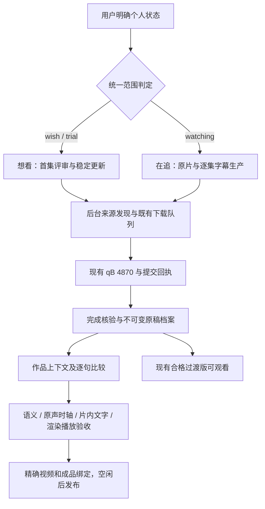

> 2026-10-15 文档整理：本文保留按日期演进的设计与实现记录。当前执行以 [项目规则](PROJECT-RULES.md)、[两阶段制作](SUBTITLE-TWO-PASS.md) 和 [定时任务](AUTOMATION.md) 为准；旧 accepted 前置、已看 experience、迅雷优先/UI heartbeat 或历史周期不自动恢复。

# 想看与在追：统一观看生产方案 v1

2026-10-14 最新用户交付优先规则见 [熟肉交付流程](SUBTITLE-DELIVERY-FIRST.md)：先完成整集熟肉供用户观看，未核疑点随版记录并在以后增量修订，不再以全面原声审校阻止首版本地成品交付。旧稿、旧默认、实际审校记录与个人/来源/下载保护保持；不得伪造 accepted。已完成的成品通过字幕库独立播放入口提供。

2026-10-13及时交付更正：本机后台准备材料，`automation-2`每15分钟仅准备/派发/跟踪；材料就绪后独立本地单集会话持续完成整集。原每小时逐句轮转被覆盖。药屋/乱马E2已看完，旧稿低优先经验保留；优先新未看集，晚稿V2复用原会话按差异核验。实际调度/未知回执/单写入保护执行 [SUBTITLE-DELIVERY.md](SUBTITLE-DELIVERY.md)，原质量、范围和发布门禁不变。

决策日期：2026-10-12。用户已确认整体方向并委托执行细节，要求研究清楚后重新下发定时任务。本文是两条定时任务共同的长期规则；具体集数、cue、hash、批次进度放在私有工作项，不塞进定时提示词。与旧流程冲突时，本次状态分流优先；独立授权、媒体保留和质量证据继续有效。

## 1. 用户最终得到什么

| 个人状态 | 目标 | 自动工作 | 能否观看 |
|---|---|---|---|
| 想看 wish / 试看 trial | 首集能判断是否喜欢，之后按选定片源稳定更新 | 首集多源实评，确定主源和备选，后续一集一版；不持续启动自制字幕 | 合格首集完成且归属核实后即可播放，选源评审可继续 |
| 在追 watching | 当前证据支持最好的洁净、保真原片＋逐集自制中日字幕 | 原片实评、逐集多稿比较、制作、整集验收、精确绑定成品 | 自制完成前保留合格过渡版；验收后下次打开使用成品 |
| 暂搁、弃番、看完、cleanup_hold、未选入个人列表 | 保留资料、历史、已有媒体 | 不新增研究下载或生产，不借目录同步恢复授权 | 沿既有播放、黑名单和清理规则 |

个人状态只由用户操作或已授权的明确状态同步改变。下载、打开播放器、播放一小段、首集源评审完成，都不能自动将想看变在追或变已看。真实 finished 与手动修正继续遵守现有观看同步规则。

普通季度独立授权的一集一版下载保持独立，它不意味着个人想看，也不自动进入两条研究任务。本次不补齐七月旧季、不扩张其它影视，不修改旧任务/文件来人为腾出样本名额。

## 2. 三层执行责任

* 前端负责表达意愿、查看实际视频/字幕来源、观看和手动修正。字幕库保留所有历史；活动生产项属于在追，想看的旧工作稿成为保留档案。页面进度不能作为验收。
* 后台负责低成本查源、门禁、torrent/manifest/hash核验、qB唯一提交、完成对账和原稿归档。禁止定时桌面操作，qB离线只记录故障，不能据此启动实例或接管其它下载器。
* 首集heartbeat只在真实材料变化时完整实评一部及更新主备；字幕heartbeat负责准备、去重派发和跟踪。真正字幕制作由独立单集会话连续完成，读取固定输入并提交实际证据；定时任务不再逐句写正文，不重复后台抓取循环，不把触发次数当生产进度。

范围判定见 `anime/viewing_workflow.py`，版本键 `viewing_workflow_policy`。只有 version=1 且 enabled=true 才启用新分流。它只增加限制，不授予下载权。`/api/viewing-workflow` 是两条任务共享的只读队列，来源于当前数据库，不是昨夜固定名单。

## 3. 想看：首集评审完成后稳定更新

1. 每轮完整扫描当前个人 wish/trial，检查 selected、独立授权、映射/盘点、首集边界、cleanup_hold 和有效研究政策。未满足的项目记录实际缺口，不自动授权。
2. 保留原首集实评方式：实物完成后检查作品季集、中文资格、广告/保真、有限画面和译文证据，区分已观察事实与未知，不造整集评分。先用现有样本，必要时补有价值的不同来源；12族/20GiB是既有安全上限，不是必须凑满的数量。
3. 合格完成首集可立即观看。已有主源不因新增样本回退到 sampling；通常保留一个主源、最多两个有实际资格的备选。没有足够合格备选就留空。
4. 继续已选主源的一集一版，沿已有 wait_hours；通常24h。先确认真实发布窗口及当前集数，再在到期且主源确实未发布时取已实评备选。缺集继续查源，不以另一季/合集或封禁发布者填位置。
5. 用户改为 watching 后，加入在追生产队列；已有首集评分、熟肉、原字幕和待核查任务都保留。用户改回 wish/trial 后停止新的逐集生产，已有在途/未知任务继续安全对账。

## 4. 在追：怎样选择视频母片

选择的是本集观看母片，字幕来源可以来自别的视频。两者分别评审和登记。

### 先过硬门槛

* 作品、明确续作季号、集数和实际文件选择正确，torrent真实hash与来源匹配；完成、尺寸、归属、目录、manifest及当前媒体指纹有效。
* 生肉，或软字幕确实可以关闭且画面没有烧录对白。发布者带 Raws、MKV 扩展名、轨道数或标题 RAW 都只是线索，必须实帧/实际播放确认。原作片内文字是要翻译的内容，不等同于发布者硬字幕。
* 不属于持久广告发布者黑名单。未知广告情况不能写为“全片无广告”；发现正片插入广告时保存时间点和证据，持久封禁发布者及别名。
* 原始保真；明确AI超分、补帧、修复、重绘或类似处理的候选按既有策略排除。日语声轨实际正确，画面/音频完整，片头片尾、下集预告和编辑版本差异有记录。

### 合格后怎样比较

优先调查具有可核实来源的原生 WEB-DL/洁净源，原生1080p可优于不明2160p；WEB-DL也是待核线索。比较同内容、同实际时间的画面，记录线条、细节、颗粒、渐变/色带、暗部、运动、裁切、水印、音质及剪辑差异。不把更大体积、HEVC10、码率、做种数当成画质实证。

用分层选择而非把所有指标糊成总分：身份/洁净/黑名单/保真 → 实际画面与声音 → 内容完整和时轴版本 → 稳定获取/播放兼容。兼容性问题优先使用已授权的复制编码数据转封装或播放器备选，原片保留，不为浏览器牺牲原始母片。

默认每集一个主候选＋一个对照候选，现有合格普通版本可复用；已有、在途或不确定的同hash都占位置。需要第三份时先记具体争议和证据，再写该集 `viewing_base_exception_<show_id>_<episode>`，max_bases=3、reason和evidence均非空；这只放宽数量，不替代下载或质量门禁。历史超过数量上限不删除，优先消化已有样本。失败任务的未知提交同样不能当空槽。

首次母片冻结前必须有可追溯的 base-review 记录：候选、精确媒体、观察范围、对照点、洁净/保真/声音事实、未决项、选取理由。冻结后新源仅作差异/质量问题调查；确认存在实质改进才建新目标版本，重新核对时间映射和所有相关验收，不继承旧集/旧目标的验收。

## 5. 对比字幕怎样选，选几份

* **中文目标为2–3份独立文本**：一份贯穿整集的主稿＋一至两份对照稿。主稿看完整性、上下文、名字/术语、遗漏、语气和可追溯性，不只按发布早或组名选；争议行逐项裁决，不机械拼接。
* **日语证据单独选**：准确对应本集的原生日语字幕/CC，加实际日语音轨与作品语境。日文原字幕也需检查听写及编辑版本。英译只能辅助理解，不能替代日语；无日文轨时ASR仅生成估算候选，仍需逐句听核。
* 归档优先免费、低成本原ASS/SRT/VTT或已核软字幕轨；实际torrent若有可明确选择的独立字幕文件，按既有可用适配器选择，未实现的文件选择不能声称成功。没有外挂才考虑已完成熟肉提取；硬字幕仅在确有比较价值时显式取研究视频/OCR，OCR只做候选。
* 不同站点、不同压制、简繁转换、同文改包装，不算不同译者。按全文规范化hash分组，并抽查误差/改动；只有正文确实独立且出处可信时才能说独立翻译。近同文需要对齐后判定，hash不同也不自动独立。
* 每集重新发现，包括晚加入组、修订稿、暂缺集；不要首集挑两组就假定整季持续有稿。少数正片争议可加第四文本调查，原稿全部存档，主要生产仍使用可追溯小组合。
* 字幕不足不无限等待：有一份可靠中文和可核日语，就先制作。如果持续查源后只有一份中文，可在完整日语/语境、原声、片内文字和渲染验收全部通过后形成“单中文基稿＋原声独立核对”的成品；真实记录限制，不能声称多译者比较完成。任何关键语义未决仍阻塞成品。

显式参考视频使用 `/api/subtitle-studio/<sid>/<ep>/acquire`，role=`subtitle_reference`，每批1–2个明确 candidate_ids。本集最多新增两份参考视频；它们只进入 subtitle_samples，不能预留/替换正式 episodes，也不豁免黑名单、保真、授权、manifest、同hash及未知提交门禁。自动洁净母片发现仍只采 raw/soft 线索，参考稿不足不能导致无限下载。

## 6. 从什么时候开始，晚稿来了怎么办

| 触发/时点 | 执行 |
|---|---|
| watching状态成立、该集已实际发布/发现且门禁有效 | 立即发现原片和字幕，归档当前可获取稿；不提前生成未播集 |
| 第一个可靠中文与日语证据到位 | 开始作品上下文、术语及语义校订；母片未冻结时标为语义工作稿 |
| 洁净母片完成并经实评选定 | 冻结媒体指纹，映射各稿时间版本，再做显示切分与声画时轴 |
| 首稿到位后24h | 检查晚到独立稿；不以24h作为完成期限，也不暂停已能推进的工作 |
| 48h仍缺必要材料 | 写明查过哪些来源、实际缺项、下一动作；已有合格过渡版仍可观看 |
| 7天或下集发布后 | 增量检查修订/晚组；只有新hash/新正文/新证据才重做相应阶段 |
| 已验收后晚稿到来 | 只做差异审阅；若发现实质错误，创建保留旧版的新修订并重验受影响证据 |

制作从首集研究建立上下文和术语，可复用资料但不复制验收。优先下一未看且材料就绪的集，已看首集/第二集不因必要术语而先做成品回补。调度先低成本扫完整在追变化，再为就绪集开启唯一负责人会话；该会话持续完成本集，不在每个20–40 parent内部保存点结束等定时触发。困难/能力阻塞具体记录并在负责人停止写入后释放整体槽给其它可操作集，同集恢复保留原负责人。重排、阴影层、截图或统计不计新增翻译。

## 7. 怎样才算完成

| 阶段 | 产物/关闭条件 | 未通过时 |
|---|---|---|
| 发现与档案 | 本集来源清单、原始文件/来源/时间/hash，不可变draft；同文分组 | 等稿/身份核对，不伪造来源 |
| 母片及主稿选定 | 精确媒体和剪辑版本、base-review、主稿＋对照清单、时间映射 | 可以改语义工作稿，不能关闭时轴 |
| 全集语义 | 全部对白parent及显示child按实际日语/语境核对，名字、否定、遗漏、同说话者等争议结清 | translation_reviewed是工作稿；逐项列未决 |
| 原声与时轴 | 实际听核和连续目标播放，检查切点、人物切换、回应、音画/镜头及阅读警告 | 原生时间戳/ASR/静帧不能替代听核 |
| 片内文字 | 全画幅逐集检查必要标题/路牌/短信等文字，内容、出现消失、运动、遮挡和对白碰撞核实 | 底部OCR或没有sign事件不能当完成 |
| 渲染与实际播放 | 当前全集逐行测宽/真实字体选字；实际全尺寸与640px图、长句/切换/运动；目标播放器ASS/字体/冷启动/缩放/暂停seek/控制条实际验收 | 字体文件存在、编译成功、静帧合集或video在播均不够 |
| 成品发布 | 四阶段实际证据齐全、原稿/父子覆盖完整、当前hash一致；正常compile/accept/select，正式观看媒体和字幕精确绑定并回读 | 媒体不是实际播放目标时仍是未激活build |

对白中文在上、日语在下，各一行；长句按日语/原声和语义边界切分，保留parent/child及覆盖证据，不均分时长、不堆四行、不缩字。白字＋克制柔阴影，无明显硬边/底框。当前Noto候选不是所有工作稿通用验收；核ASS family、OS/2、libass选字、精确字体/hash和当前图像后才应用。

一集完成按“整集通过/尚未通过”表达；书面行数可以另列。决不把校订比例当成整集完成率。能力不可用时在 acceptance-plan.json 记录具体无法听音/运动/目标播放器的能力、受影响集/区间、当前文件hash及下一关闭动作，保留阻塞并推进其它可做阶段。导出音频不等于听过，生成证书字段不等于真验收。

## 8. 自制未完成时怎样看

默认继续已有归属核实、完成且未被黑名单排除的合格中文过渡版，后续按已有选源流程更新。没有中文合格版就如实缺集/等字幕；不自动用无字原片或未验收工作稿替代。用户主动选择已提供的生肉/原轨关闭选项时，可以按现有播放器能力看原片。

自制QA使用隔离、非默认预览，明确是工作稿；不为了预览将build先accept。新字幕通过后空闲时切换正式组合，下次打开使用它；正在看的会话不强制重载或中途换视频/字幕。原片、旧视频、原轨、已验收旧版与观看状态保留。不同剪辑之间的播放进度只有验证映射后才继承；不直接复制时间戳，更不能写finished。

若自制完成但浏览器/TV ASS或字体加载失败，仍提供原合格过渡版和可用播放器路径，显示真实失败和实际使用轨；不得以“已选择字幕”冒充加载成功。

## 9. 私有工作项契约与任务调度

工作项存放于 `data/subtitle-studio/production-plans/<show_id>/E<episode>/`（可复用已有本集目录并保存索引），至少：

* plan.json：当前个人范围快照、母片候选/冻结指纹、基稿角色及独立性、版本映射、下一操作、优先级、租约/持有人；计划版本不能替代真实验收。
* base-review.json、comparison.json：实际观察、原稿和证据引用、选择理由、不确定性；引用文件及hash。
* acceptance-plan.json：semantic/timing/screen_text/render各自事实、剩余区间、关闭证据、能力阻塞。现有workbook是唯一正文，不另造一份会分叉的字幕稿。
* run记录：本轮输入/输出hash、读取及复用证据、实际变化、后续操作；保存前检查当前workbook/计划版本，冲突就重读，不覆盖并行修改。

旧临时批次说明不重跑；读取最新PROGRESS/HANDOFF和实际工作稿。两条任务按当前状态独占责任，状态迁移时保留工作项并交由新流程读取。后台仍是唯一下载执行者，任务通过现有API提交意图，不从第二个Engine进程直接调用qB。人工判断使用现有source-review review/choose接口保存证据，不写假分。

两条heartbeat保持各自原聊天目标；字幕调度每15分钟，想看首集检查每小时：

| Automation ID | 新名称 | 责任 |
|---|---|---|
| automation-3 | 想看首集评审与稳定更新 | 只负责当前wish/trial，首集选择、更新缺口及后台健康 |
| automation-2 | 字幕材料准备与整集会话派发 | 只负责当前watching的准备/派发/跟踪，正文/验收由单集会话完成 |

每轮完整扫描＋有预算的实际推进；失败来源共享冷却，不能让一个403/522站点阻塞所有作品。保持当前后台RSS节奏，不再创建小时级重复RSS任务。两条提示词短而稳定，任务从本文和实时队列恢复。

无变化、旧问题重复、尚未到期、非可操作等待时安静。新合格首集、真实选源变化、整集成品激活、首次影响观看的失败或明确需要用户操作时才通知，记录通知指纹防重复。无需用户逐项批准既有授权内的细节和通过验收后的激活；公开分享另需明确目的地授权。

## 10. 本轮落地边界与后续执行顺序

本轮已经实现：后台按状态分流；想看不再新增逐集自制任务；在追每集主/对照原片数量门禁；普通合格中文过渡版可以继续交付；显式参考视频角色和受控API；在途/未知提交保护；实时队列；两条定时提示词重写和回读验证。发布结果以PROGRESS/HANDOFF实际部署及回执为准，设计文字不能作为部署证据。

2026-10-13 10:09–10:11只读更正：受控研究母片冻结和空闲发布代码已存在，三集 `production-target` GET均实际HTTP200返回空目标；旧计划中的404不再代表当前路由状态。宿主targets/heads/publications和字幕build/accepted/selection均为0，尚未实际冻结或发布。`refresh_job`已有冻结目标分支；没有冻结目标时继续使用既有正式媒体，研究样本不会自动变成正式播放视频。下一步是实际原声/连续预览能力核验、合格母片实评与受控冻结，再完成四阶段验收和正式播放绑定；不得直接覆盖episodes绕过完成/归属/验收。不同目标不继承过渡视频的声画证据。

字幕效率与首个完集流程见 [SUBTITLE-PRODUCTION-PIPELINE.md](SUBTITLE-PRODUCTION-PIPELINE.md)：优先药屋E2能力与母片闭环，1集主生产＋最多1集材料预备，连续场景校订、集中声画/风险QA、单写入合并、晚稿差异复核及分别计时。全在追低成本扫描和既有后台查源保留；任何具体能力缺口继续明示，不伪造听核/运动/播放器验收。该文档是2026-10-13执行方案，单写入接口、自动缓存和阶段计时尚未因此部署，两条自动化配置与时刻不变。

整套API/worker/jobs/runs/outbox分进程迁移、任务中心完整重构，沿 `architecture-review-20261011/analysis.md` 的后续阶段执行。本轮不多开uvicorn、不把模型任务当后台循环、不重置凭据。新功能采用临时DB和假下载器验证，不在测试时连生产提交。

## 11. 研究依据与适用限制

* [本项目现状和迁移分析](architecture-review-20261011/analysis.md)：代码、只读数据库及真实自动化配置，不根据旧文档推断当前状态。
* [Netflix简中字幕规范](https://partnerhelp.netflixstudios.com/hc/en-us/articles/215986007-Chinese-Simplified-Timed-Text-Style-Guide)：阅读速度、屏幕文字和语义连贯可作风险检查参考。其单语16字/行、成人9字/秒等不是本项目双语排字的强制阈值，更不能要求缩字；本项目用户样式及实际测宽/声画审阅优先。
* [FFprobe官方文档](https://ffmpeg.org/ffprobe.html)：容器/流/帧元数据可用于实际媒体盘点，不能仅凭轨道或标签证明画面无硬字、无广告或日语确实正确。
* [OpenAI Docs：Automations](https://learn.chatgpt.com/docs/automations?surface=app)：调度能力按当前桌面工具实际配置/回读结果核实，运行是后台继续工作的入口，定时触发不证明成品。
* `video-subtitle-studio` 当前workflow/completion/alignment、字幕库及native-source规则：不可变来源、原声/实际渲染、精确hash、同文独立性和正常accept/select。

两份母片、2–3中文稿、24h/48h/7天复查和20–40 parent批次是本次选定的项目执行策略，不是外部规范或已经通过的人体可读性实验。SubsPlease/Erai FAQ本轮网络工具不可访问，不引用其搜索摘要证明原生画质或日语轨可用性。
